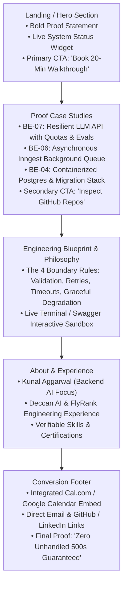

# Draw the Path — Portfolio Sitemap & Architecture

**Intern:** Kunal Aggarwal  
**Track:** General AI Fluency & Backend AI Engineering  
**Submission Date:** October 2026  
**Status:** Completed  

---

## 1. Portfolio Sitemap & Architecture

To walk an engineering manager from initial landing to believing the proof and taking the target action (booking a code walkthrough), the site is intentionally designed as a lean, single-page progressive disclosure application with no decorative filler.

### Sitemap Flow (Mermaid Diagram)



---

## 2. Page & Section Breakdown

Every single block earns its place strictly by advancing the visitor toward the single target action:

1. **Hero Header (Landing):**
   - **Visitor State:** Skeptical, giving this 5–10 seconds.
   - **Content:** Exact Proof Statement in high-contrast typography; real-time indicator (`● API Status: Healthy | Latency: 42ms | LLM Fallback: Active`).
   - **Direct Action:** Two buttons: `[Book 20-Min Technical Walkthrough]` and `[Jump to Code & Architecture]`.

2. **Core Case Studies (Belief Engine):**
   - **Visitor State:** "Show me you can write real code, not just ChatGPT prompts."
   - **Content:** 3 deep-dive cards with live curl commands, architecture diagrams, and links to GitHub commits.
     - *Case 1:* Resilient LLM Triage Endpoint with Pydantic validation, 30s hard timeout, single retry repair, and 8/8 test evals.
     - *Case 2:* Durable Background Processing Engine running Inngest workers with 3-step retries and exponential backoff.
     - *Case 3:* Containerized Multi-Tenant Metering Engine with Stripe webhook idempotency.

3. **Interactive Terminal Sandbox (Interactive Proof):**
   - **Visitor State:** "Can I test this right now?"
   - **Content:** An embedded, responsive terminal simulator running pre-recorded or live API calls against our endpoints showing 200, 202, 400, and 422 JSON responses.

4. **Conversion / Scheduling Section (Closing the Action):**
   - **Visitor State:** Convinced of engineering competence; ready to interview.
   - **Content:** Direct 1-click scheduling widget (Cal.com / Google Calendar) + direct links to GitHub, LinkedIn, and clean resume download.

---

## 3. Configured Claude Project Setup

A dedicated Claude Project titled **`Portfolio Tutor & Architect`** was created with custom instructions:

```markdown
Project Title: Kunal Aggarwal Portfolio Architecture
System Context & Custom Instructions:
You are an uncompromising Senior Principal Backend Architect and Technical Recruiter.
Your student is Kunal Aggarwal, completing the FlyRank Backend AI Engineering program.

Standing Proof Statement:
"I design and ship resilient, observable backend systems that place LLMs and background workers 
behind strictly validated, failure-tolerant API contracts. For engineering managers and technical 
founders at AI-first startups who cannot afford broken pipelines, hallucinated schemas, or unmetered 
quota leaks, I demonstrate through reproducible code, live status endpoints, and stress-tested evals 
that I write production software that survives dependency outages. Book a 20-minute technical code 
walkthrough of my active system."

Instructions:
1. Act as a harsh tutor: Pressure-test every UI element, copy line, and route against the target action.
2. Reject any proposed page, blog, or animation that distracts from the proof statement.
3. Insist on clear, reproducible technical proof (curl outputs, status codes, architecture diagrams).
```

---

## 4. The Pressure-Test Prompt & Output

### Prompt Submitted to the Project:
> *"Here is my draft portfolio sitemap: Hero (proof statement + CTA) → 3 Case Studies (LLM API, Inngest Queue, Containerized DB) → Interactive Terminal Sandbox → About Me & Experience → Cal.com Booking Footer. Pressure-test this sitemap against my one claim (resilient backend AI systems) and my one action (booking a 20-minute code walkthrough). Tell me what is redundant, what is missing, and what breaks the visitor's focus."*

### Thinking Partner Critique Output:
> **Critique:**
> 1. **Friction in the Sandbox:** An interactive terminal is exciting, but if the backend demo is slow or requires complex parameters, the hiring manager will bounce before reaching the booking form. Make sure the interactive sandbox has 1-click preset buttons (e.g. `[Test Validation Error]`, `[Test Quota Boundary]`) so they don't have to type anything.
> 2. **Case Study Overload:** If your case study summaries look like academic papers, nobody will read them. Each case study must lead with three metrics: *The Failure Mode Prevented*, *The Code Contract*, and *The Live Endpoint*.
> 3. **The About Section Trap:** A standard "About Me" detailing college coursework or generic hobbies weakens the high-conviction positioning. Merge your experience directly with the case studies and keep the bio to 3 bullet points: tech stack, Deccan AI / FlyRank internship impact, and contact links.
> 4. **Missing Proof of Observability:** You claim to build "observable" systems, but the sitemap didn't show where an engineering manager can see your logs or metrics. Add a "Production Hygiene" badge or collapsible log preview to your primary case study.

---

## 5. Changes Implemented Based on Critique

1. **Streamlined About Section:** Eliminated a standalone multi-paragraph "About Me" page. Replaced it with a 3-bullet concise sidebar directly alongside the booking calendar.
2. **Preset Sandbox Triggers:** Added pre-configured buttons (`[Simulate 429 Quota Exceeded]`, `[Simulate LLM Retry]`, `[Inspect Health Check]`) to ensure the visitor sees instant results without typing.
3. **Log & Observability Proof:** Added an explicit "Structured Cost & Latency Log" visual snippet to Case Study 1, directly supporting the "observable" claim.
4. **Sticky Micro-CTA:** Added a persistent, non-intrusive header CTA `[Book Walkthrough]` so the visitor never has to scroll all the way to the footer once convinced.
